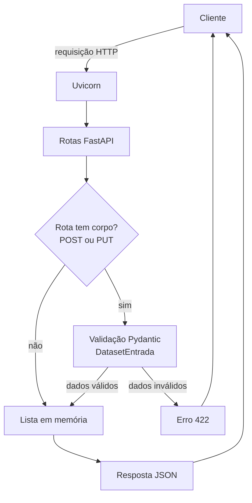
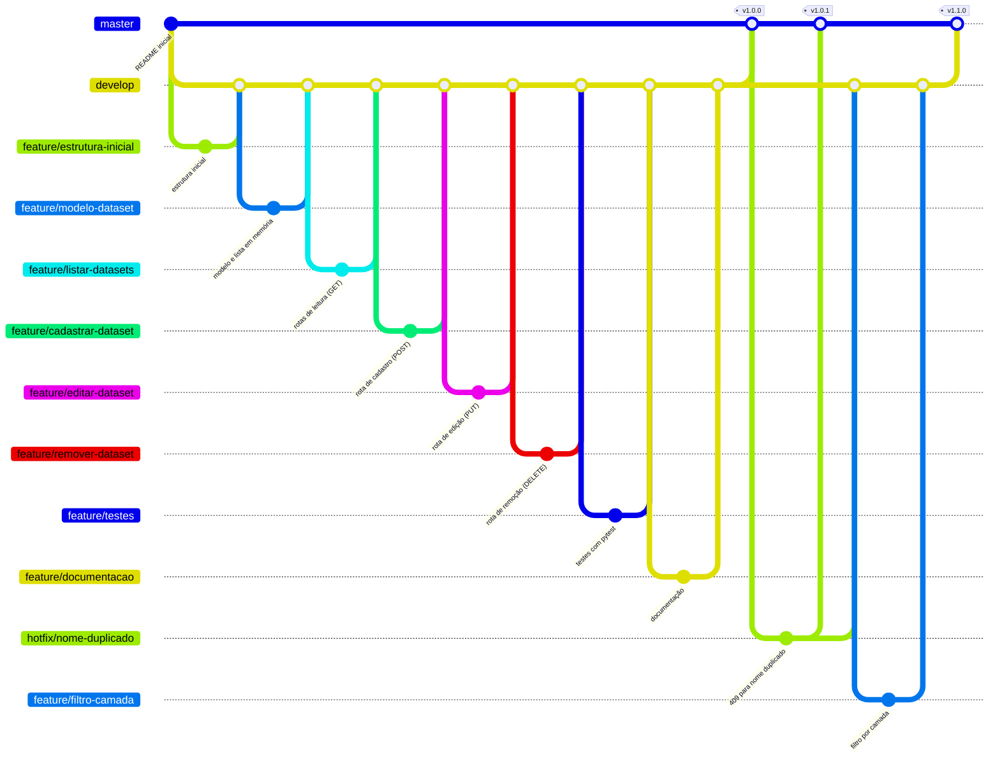

# API Catálogo de Datasets

API REST simples para cadastrar e consultar os metadados dos datasets de uma equipe, feita em Python com FastAPI.

## Sobre

Em empresas grandes, os dados ficam espalhados em bancos, arquivos e data lakes, e muitas vezes ninguém sabe o que existe, onde está e quem é o responsável por cada base. Um catálogo de dados resolve esse problema guardando os metadados de cada dataset, ou seja, informações sobre os dados: nome, descrição, fonte, formato, camada e responsável.

Esta API é uma versão mínima desse catálogo, com as operações de cadastro, consulta, edição e remoção.

## Arquitetura



O cliente envia a requisição HTTP, que o Uvicorn recebe e passa para a rota correspondente do FastAPI. Rotas com corpo (`POST` e `PUT`) passam primeiro pela validação do Pydantic: se os dados forem inválidos, a API responde `422` direto, sem tocar na lista em memória; se forem válidos (ou se a rota não tem corpo, como `GET` e `DELETE`), a requisição chega até a lista em memória, que guarda os datasets, e a API devolve a resposta em JSON.

## Modelo de dados

| Campo | Tipo | Quem preenche | Exemplo |
|---|---|---|---|
| id | inteiro | servidor (automático) | 1 |
| nome | texto | cliente | `vendas_2026` |
| descricao | texto | cliente | "Vendas diárias por loja" |
| fonte | texto | cliente | "Oracle" |
| formato | texto | cliente | "csv", "parquet" ou "json" |
| camada | texto | cliente | "bronze", "prata" ou "ouro" |
| responsavel | texto | cliente | "Time de Vendas" |

O campo `camada` segue o conceito de arquitetura medalhão (Lakehouse): **bronze** são os dados crus, como chegaram da fonte; **prata**, os dados já limpos e padronizados; **ouro**, os dados prontos para o negócio, como relatórios e dashboards.

## Endpoints

| Método | Rota | O que faz | Status de sucesso | Erro |
|---|---|---|---|---|
| GET | `/health` | Verifica se a API está no ar | 200 | - |
| GET | `/datasets` | Lista todos os datasets | 200 | - |
| GET | `/datasets/{id}` | Busca um dataset pelo id | 200 | 404 |
| POST | `/datasets` | Cadastra um novo dataset | 201 | 422 |
| PUT | `/datasets/{id}` | Edita um dataset existente | 200 | 404 |
| DELETE | `/datasets/{id}` | Remove um dataset | 204 | 404 |

## Como executar

Pré-requisitos: Python 3.11 ou mais novo e Git.

1. Clone o repositório e entre na pasta:

   ```bash
   git clone https://github.com/thiagofiel-stefanini/api-catalogo-datasets.git
   cd api-catalogo-datasets
   ```

2. Crie e ative o ambiente virtual:

   ```bash
   python -m venv .venv
   source .venv/Scripts/activate
   ```

   No PowerShell, o comando de ativação é `.venv\Scripts\Activate.ps1`. No Linux e no macOS, é `source .venv/bin/activate`.

3. Instale as dependências:

   ```bash
   pip install -r requirements.txt
   ```

4. Inicie o servidor:

   ```bash
   uvicorn main:app --reload
   ```

5. Acesse a documentação interativa em http://127.0.0.1:8000/docs.

## Exemplos

Requisição `POST /datasets`:

```json
{
  "nome": "vendas_2026",
  "descricao": "Vendas diárias por loja, usadas no dashboard de faturamento",
  "fonte": "Oracle",
  "formato": "csv",
  "camada": "bronze",
  "responsavel": "Time de Vendas"
}
```

Resposta (`201 Created`):

```json
{
  "id": 1,
  "nome": "vendas_2026",
  "descricao": "Vendas diárias por loja, usadas no dashboard de faturamento",
  "fonte": "Oracle",
  "formato": "csv",
  "camada": "bronze",
  "responsavel": "Time de Vendas"
}
```

## Git Flow



O projeto segue o Git Flow: a `master` guarda só as versões estáveis (marcadas com tags), a `develop` integra as funcionalidades, cada `feature/*` nasce da `develop` e volta a ela por Pull Request, e correções urgentes saem de um `hotfix/*` direto da `master` e voltam para a `master` e para a `develop`.

## Changelog

### 1.0.1

- Corrige o `POST /datasets`: passa a responder `409 Conflict` quando já existe um dataset com o mesmo nome, sem diferenciar maiúsculas de minúsculas

### 1.0.0

- Primeira versão: cadastro, consulta, edição e remoção de datasets, com testes automatizados e documentação no README
